# Beyond the Alert — SOC Investigation Automation

### Splunk, n8n and AI for analyst investigation

**Author: Jayanth**

Beyond the Alert turns security alerts into structured investigation packages: preserve Windows event context, route alerts through authenticated n8n intake, add relevant indicator research and an advisory AI assessment, and prepare DFIR-IRIS case details and analyst notifications. The repository includes five reproducible synthetic scenarios and a recorded suite of 94 passing behavioral checks. The goal is a consistent, reviewable handoff that reduces repeated investigation preparation.

## Watch the project in 96 seconds

https://github.com/user-attachments/assets/dd987e7c-7482-44d4-8458-6b449489ce47

*A 96-second illustrated project overview featuring Jim, a fictional SOC analyst.*

**For the full video with multilingual audio and subtitle options, [watch on YouTube](https://youtu.be/ZuyXWEKCFKM).** Choose an available audio track or Subtitles/CC in YouTube settings.

**[Read the project walkthrough on Medium](https://medium.com/@nameisnani2027/beyond-the-alert-connecting-splunk-n8n-and-ai-for-soc-investigation-4f64caa74746)** for the investigation story and current implementation notes.

> **Splunk → n8n → advisory LLM analysis + relevant threat intelligence → DFIR-IRIS → Slack → analyst review**

## Pipeline Architecture

The workflow connects detection, investigation context and an analyst handoff. Response and closure remain analyst responsibilities.

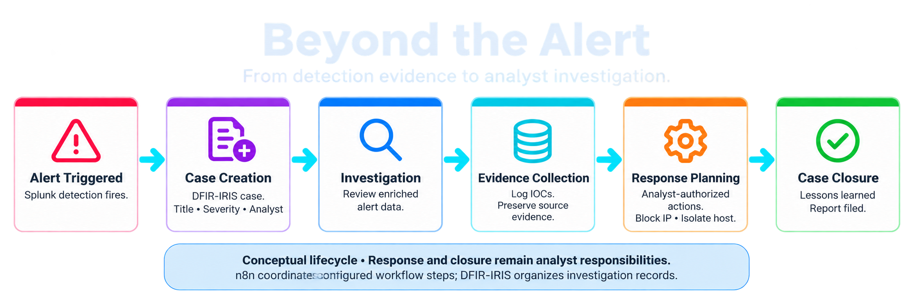

*Conceptual investigation lifecycle from alert to case closure. [Full-resolution PNG](assets/investigation-lifecycle-transparent.png). The worker supports investigation preparation; analysts authorize response through separate tooling. [Original lifecycle figure](assets/lab/06-incident-lifecycle.png).*

The lab overview shows the component relationships. The current implementation routes authenticated alerts to a protected worker, enriches relevant indicators and validates one advisory assessment. The earlier lab diagram uses a two-stage model layout; see the [artifact guide](docs/artifacts.md) for that version. [Current component map](assets/architecture.png) · [Actual execution sequence](docs/architecture.md).

## What Makes This Project Different

The project brings together three questions that matter to a SOC analyst:

- **Does additional context improve the handoff?** The supplied lab evaluation compares a manual baseline, LLM-only processing and an enriched configuration.
- **Can the finding be checked?** Alert identities, source timestamps, event references and investigation links remain attached to the case-preparation package.
- **What happens when something fails?** The maintained implementation checks input and model output, records partial failures and avoids blind repeat case writes.

### Reported comparison: manual, LLM-only and integrated

**Reported lab comparison:** descriptive means recalculated from 15 source evaluation records. These records cover the historical lab configurations; [current implementation verification](docs/validation.md) is documented separately.

| Metric | Manual baseline — A | LLM-only — B | Integrated — C |
|---|---:|---:|---:|
| Reported runs | 5 | 3 | 7 |
| Mean recorded triage time | 209.00 s | 130.00 s | 38.11 s |
| Mean action quality / 5 | 3.00 | 4.00 | 4.57 |
| Mean context quality / 5 | 3.60 | 3.00 | 4.29 |
| Mean analyst steps | 6.60 | 3.00 | 3.86 |

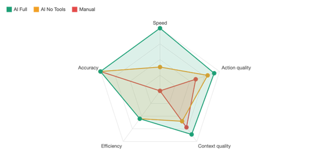

*Artifact 14 — reported normalized comparison chart. [Full resolution](assets/lab/14-reported-comparison.png). Use the CSV table for numerical means; [evaluation notes](docs/evaluation/README.md) explain the source-reported accuracy axis and scoring definitions.*

**How to read the result:** the integrated group has the lowest reported mean time and highest reported action/context ratings in this sample. LLM-only has fewer recorded analyst steps, but omits enrichment. The groups have different scenario mixes and quality is reported scoring; these results do not establish a causal speed improvement or detection-accuracy percentage for the maintained worker. [Data, definitions and limitations](docs/evaluation/README.md).

## Whitepaper — Beyond the Alert

**[Read or download the 13-page whitepaper](reports/Beyond_the_Alert_Whitepaper.pdf)**

[Download the PDF](https://raw.githubusercontent.com/karrijayanth65/Beyond-the-Alert/main/reports/Beyond_the_Alert_Whitepaper.pdf). The file page also offers GitHub’s document preview.

<a href="reports/Beyond_the_Alert_Whitepaper.pdf">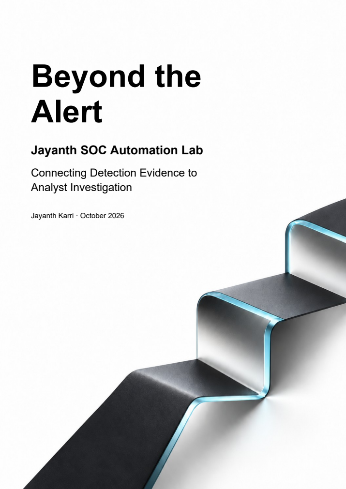</a>

*Beyond the Alert — Jayanth SOC Automation Lab: Connecting Detection Evidence to Analyst Investigation.* The cover edition follows the problem, architecture, investigation example, supplied evaluation and practical next steps. [Reading and source notes](docs/whitepaper-guide.md).

For the maintained JavaScript implementation, [the separate implementation paper](reports/Jayanth_Whitepaper.pdf) explains reproducible synthetic verification and the service-integration work that remains.

## Pipeline in Action

The following lab artifacts illustrate workflow configuration, case context and analyst notifications. They are organized from **Final Copy of Artifacts** using **Bible for Artifacts and info.MD**. Capture history, presentation updates and the relationship to current-code examples are documented in the [artifact guide](docs/artifacts.md) and [integrity manifest](assets/lab/provenance.json).

### n8n Workflow Canvas


*Artifact 01 — [full resolution](assets/lab/01-n8n-workflow.png). Workflow configuration and pinned samples document the automation logic and example data flow. The earlier export requires route reconnection. The [maintained export](workflows/jayanth.json) has connected routes and remains inactive until configured and service-validated.*

The analyst should be able to trace the alert context into the research and case requests. In the maintained send path, IRIS case creation precedes Slack notification; High/Critical severity gates Slack, not case creation.

### Slack Alert — Analyst Notification

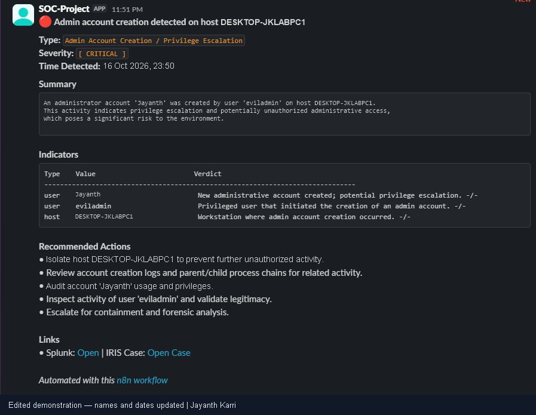

*Artifact 02 — [full resolution](assets/lab/02-slack-notification.png). Analyst notification with host/account context, investigation links and recommended follow-up. Analysts approve response actions.*

A useful notification answers: which host, which account, why this matters and where to inspect the evidence. The analyst validates the recommendation before acting.

### DFIR-IRIS — Case Creation View

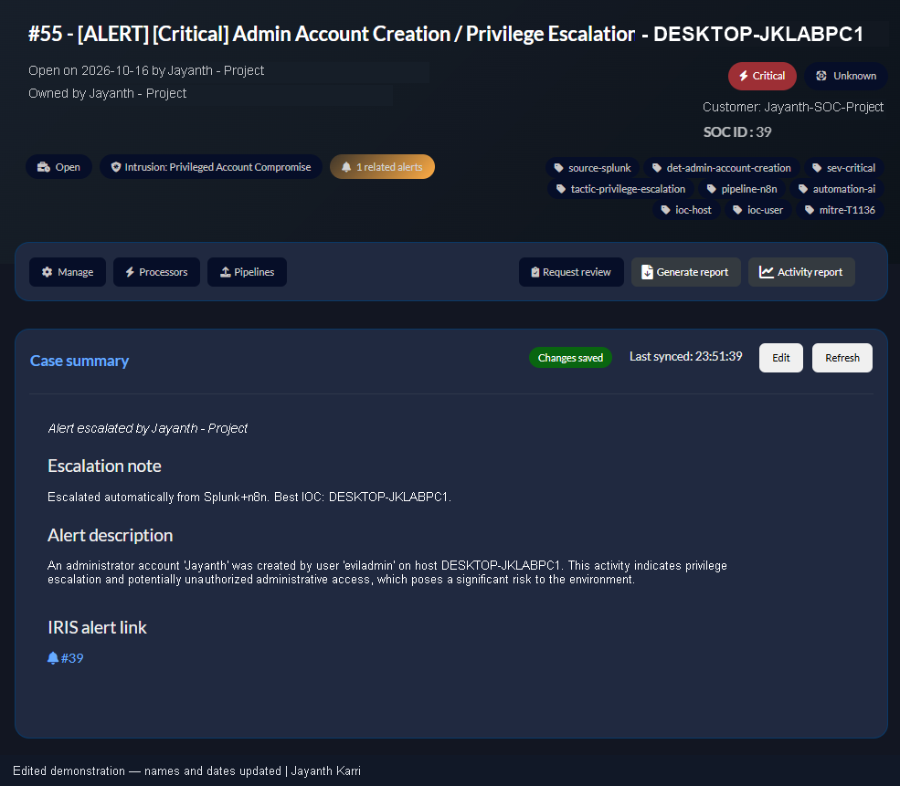

*Artifact 03 — [full resolution](assets/lab/03-iris-account-case.png). Open investigation case showing severity, related alert context and recommended follow-up. [Source context](docs/artifacts.md).*

### DFIR-IRIS — Investigation Queue

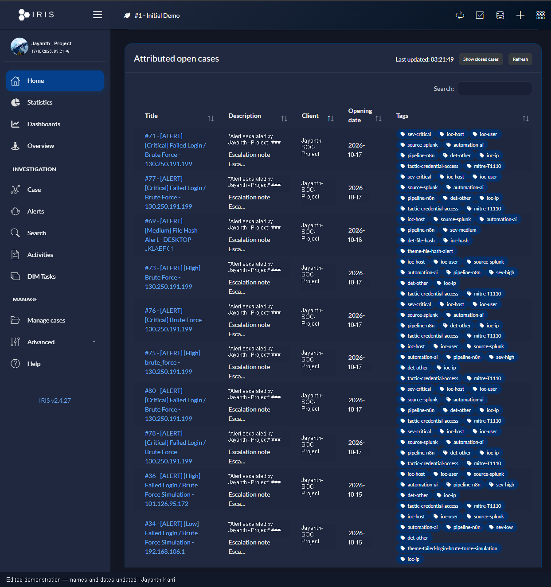

*Artifact 10 — [full resolution](assets/lab/10-iris-case-queue.png). Open investigation queue showing case priorities and triage workload.*

## Lab Environment

The supplied lab documentation describes five VMware machines on the VMnet8 NAT subnet `192.168.106.0/24`.

| Machine | Documented operating system | Role | Address |
|---|---|---|---|
| Windows client | Windows 10 Pro | Endpoint and telemetry source | `192.168.106.128` |
| Splunk server | Ubuntu 24.04 | Log search and detection | `192.168.106.129` |
| n8n server | Ubuntu 24.04 | Workflow routing | `192.168.106.130` |
| DFIR-IRIS server | Ubuntu 24.04 | Investigation case management | `192.168.106.131` |
| Kali Linux | Kali Linux | Authorized lab simulation role | `192.168.106.133` |

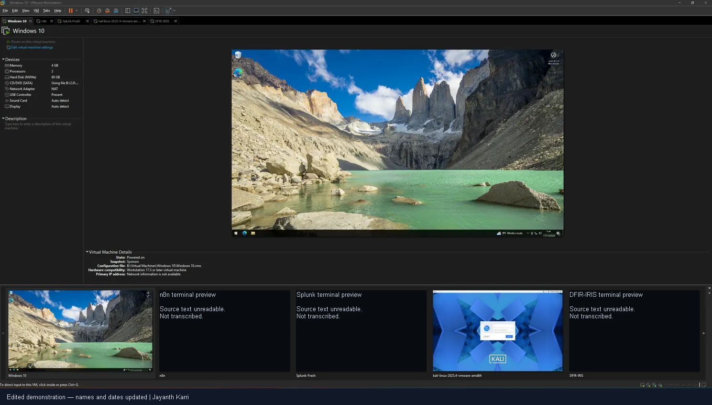

*Artifact 04 — [full resolution](assets/lab/04-lab-machines.png). VM inventory showing the endpoint, simulation and SOC service roles.*

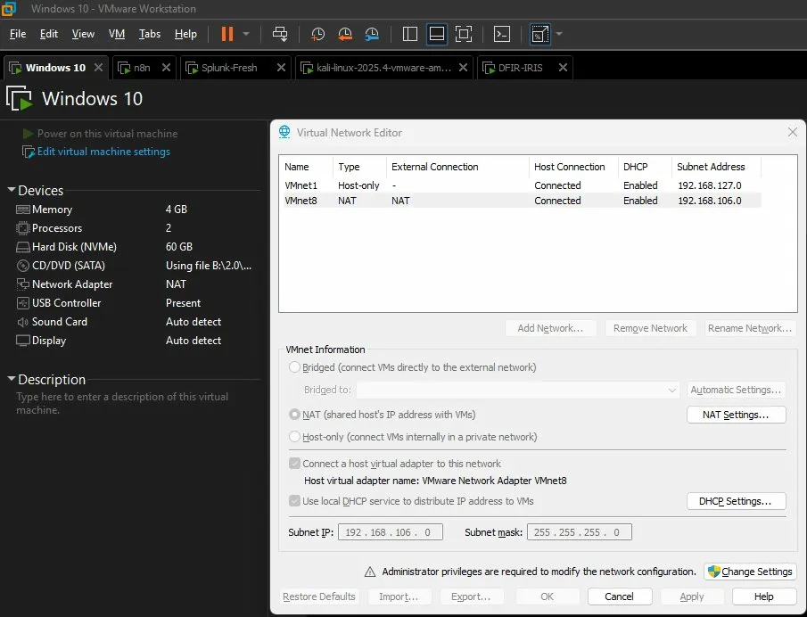

*Artifact 05 — [full resolution](assets/lab/05-nat-network.png). Documented VMnet8 NAT subnet and outbound connectivity configuration. See the [deployment guidance](docs/setup.md) for access and transport controls.*

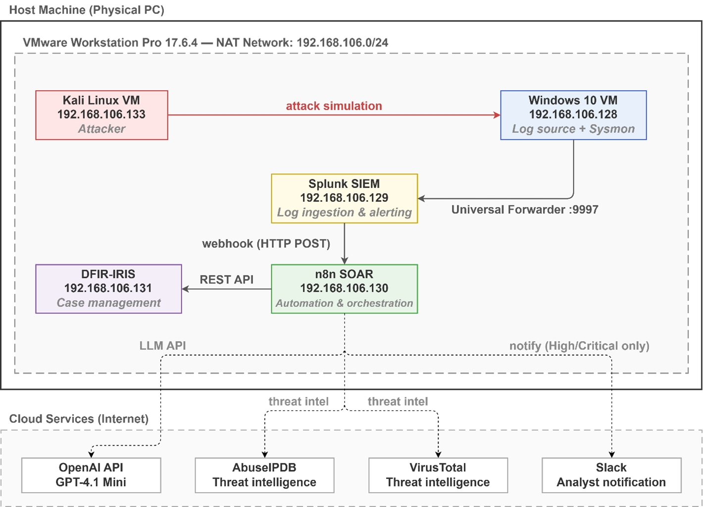

*Artifact 13 — [full resolution](assets/lab/13-network-topology.png). Lab topology and service communication paths.*

<details>
<summary>View the supplied component and data-flow map</summary>

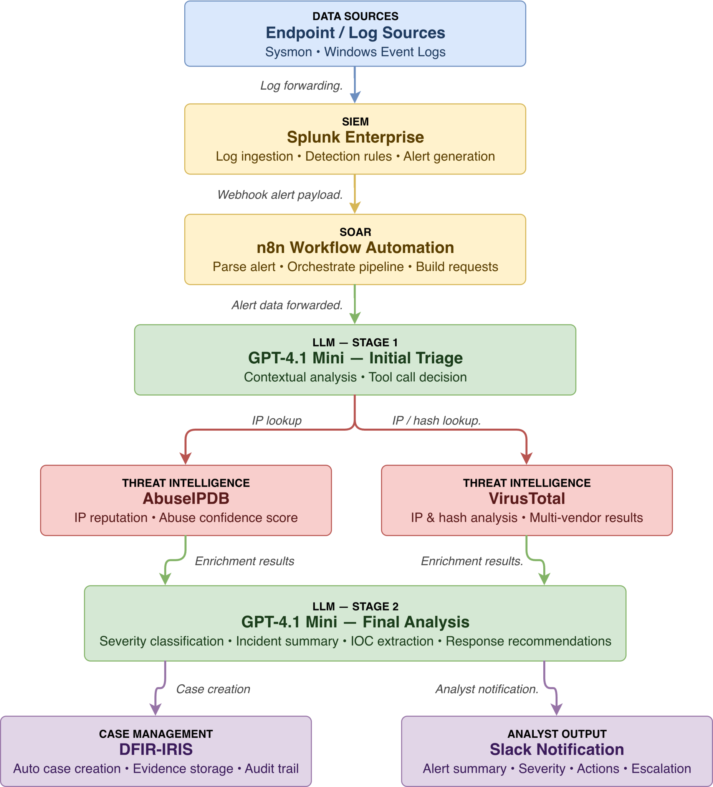

*Artifact 07 — [full resolution](assets/lab/07-pipeline-architecture.png). Its two model stages differ from the maintained worker's enrichment-first, single-assessment sequence. [Current implementation architecture](docs/architecture.md).*

</details>

## Three Pipeline Configurations

The reported evaluation compares three lab configurations: Manual, LLM-Only and Integrated. The current worker has its own [verification record](docs/validation.md) and delivery modes.

### Pipeline A — Manual Baseline

The analyst searches logs, researches indicators, assesses the finding and prepares case notes manually. Five reported rows provide the baseline in the supplied dataset.

### Pipeline B — LLM-Only

The alert receives an advisory model assessment without external reputation enrichment. The supplied notes describe disabling the enrichment tool nodes in the shared workflow, rather than maintaining a separate B export. Three reported rows cover brute-force, file-hash and scanning scenarios.

### Pipeline C — Fully Integrated / Primary Evaluation Configuration

The supplied design combines model analysis, relevant AbuseIPDB/VirusTotal lookups, case preparation and analyst notification. Seven reported rows cover all five scenario types. The public-indicator substitutions described in the source evaluation exercise enrichment; they are not evidence that a private lab address had public malicious reputation.

The maintained implementation separately supports `prepare` and `send` delivery modes. Its synthetic examples use substitute adapters. **Prepare mode with real configured adapters may still make research/model calls**; it only suppresses downstream case and notification writes. [Setup and execution boundaries](docs/setup.md).

## Attack Scenarios

The table connects each investigation question to the relevant ATT&CK behavior and available event context. The time and action-quality columns summarize the **supplied integrated rows**; they are not new risk scores or live measurements.

| Scenario | ATT&CK mapping to investigate | Evidence | Reported integrated mean | Action quality / 5 |
|---|---|---|---:|---:|
| Brute-force authentication | [T1110 — Brute Force](https://attack.mitre.org/techniques/T1110/) | Windows 4625; account, source and count | 43.00 s | 4.50 |
| File execution / hash investigation | [T1204.002 — Malicious File](https://attack.mitre.org/techniques/T1204/002/) only if user execution is established | Sysmon 1, SHA-256 and process context | 40.50 s | 4.50 |
| Network scanning candidate | [T1046 — Network Service Discovery](https://attack.mitre.org/techniques/T1046/) | Blocked connection pattern and destination ports | 35.20 s | 4.00 |
| Account creation / administrator-group change | [T1136.001 — Local Account](https://attack.mitre.org/techniques/T1136/001/); [T1098.007 — Additional Groups](https://attack.mitre.org/techniques/T1098/007/) | Windows 4720/4732; actor, subject and group SID | 30.60 s | 5.00 |
| Suspicious PowerShell | [T1059.001 — PowerShell](https://attack.mitre.org/techniques/T1059/001/) | Sysmon 1 / Windows 4688; process and command line | 34.00 s | 5.00 |

**Use ATT&CK mapping to guide correlation.** A failed-login count does not establish compromise. A process hash alone does not establish user execution of malware. Group membership can be legitimate administration, and encoded PowerShell can be used by approved tools. Correlate the source before escalating. [Scenario definitions and evidence requirements](docs/scenarios.md).

### Splunk Detection Rules

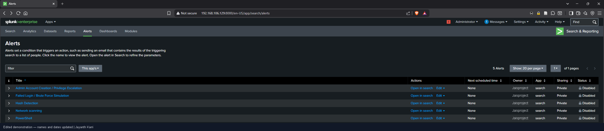

*Artifact 11 — [full resolution](assets/lab/11-detection-rule-status.png). Saved detection-rule inventory, captured with all five schedules Disabled. Activation and baseline checks are part of the [deployment checklist](docs/setup.md).*

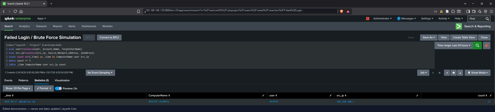

*Artifact 08 — [full resolution](assets/lab/08-failed-login-detection.png). Event 4625 aggregation supplies host/account/source context; matching results and alert scheduling are separate checks.*

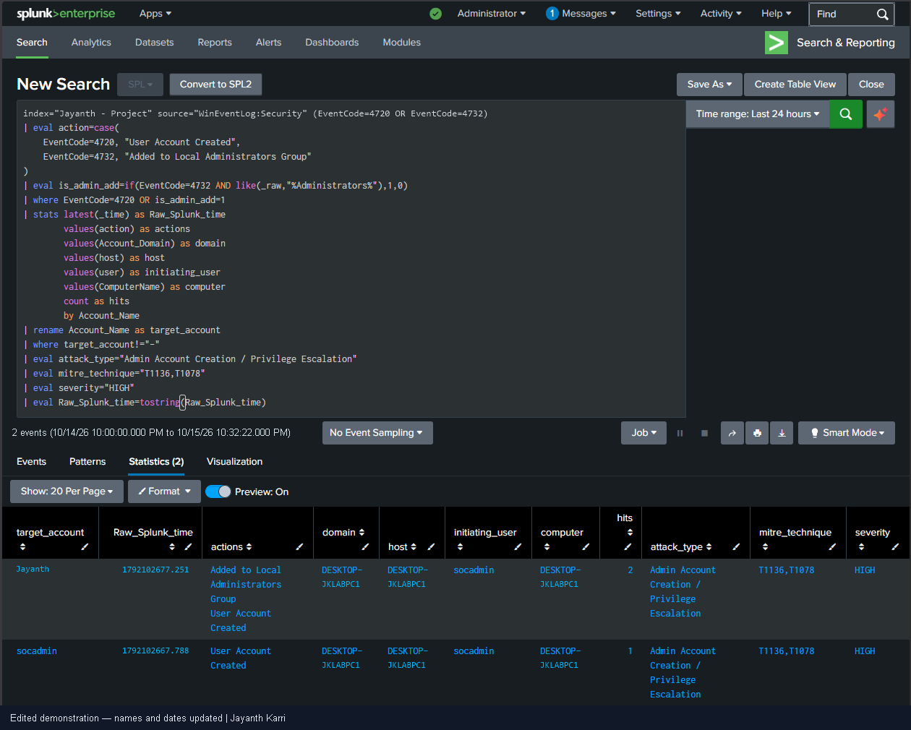

*Artifact 12 — [full resolution](assets/lab/12-account-change-detection.png). Separate the initiating user from the changed account on `DESKTOP-JKLABPC1`; retained labels are source fields, not proof of intent.*

[Read the maintained SPL examples](detections/README.md). Thresholds are lab starting points; field mapping, observation windows and false-positive tuning need validation against the deployed index.

### Endpoint Telemetry — Sysmon

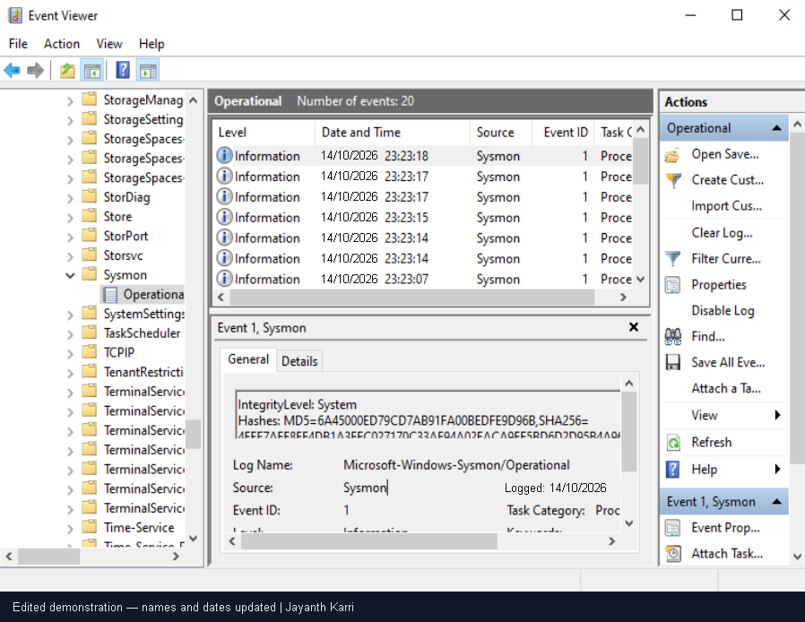

*Artifact 09 — [full resolution](assets/lab/09-sysmon-telemetry.png). Process lineage, command line and a complete hash support investigation. Where the view clips a hash, retrieve the original event before a lookup.*

## Key Results — Explained

### Why the integrated configuration is interesting

Its supplied rows record a mean of **38.11 seconds**, compared with **209.00 seconds** for Manual. Relevant external context is combined with a case-oriented handoff. That is a useful design hypothesis to test; the unequal scenario groups do not establish a controlled performance gain for the maintained implementation.

### Why fewer steps do not automatically mean a better investigation

The supplied LLM-only group averages **3.00 analyst steps**, compared with **3.86** for Integrated and **6.60** for Manual. LLM-only omits reputation enrichment. A smaller count can reflect missing work rather than a more complete investigation.

### Why context and action quality are separate

Integrated rows have mean action/context ratings of **4.57/5 and 4.29/5**; LLM-only records **4.00/5 and 3.00/5**. A specific action recommendation and evidence-rich context are different qualities. These supplied ratings are not an independent accuracy measure or proof that enrichment alone caused the difference.

### Measurement definitions and scope

The table uses the original `triage_time_s` values. The retained dashboard explains reported totals for runs 1, 3, 6 and 7 as including detection and pipeline processing. No recorded value is replaced. The CSV does not contain the ground-truth/prediction fields needed to independently substantiate a “100% classification accuracy” claim. [Evaluation notes and data](docs/evaluation/README.md).

## Validation Status and Next Milestones

| Area | Boundary and next step |
|---|---|
| Evidence sources | Lab figures, historical evaluation and current-code examples have separate provenance and verification records. See the [artifact guide](docs/artifacts.md). |
| Evaluation | The reported comparison contains 15 rows with unequal scenario coverage and reported quality scoring. A matched current-worker evaluation is a future milestone. |
| Service integration | Next milestone: validate deployed SPL, canonical alert mapping, n8n import and actual provider/model/IRIS/Slack contracts under one correlated run ID. |
| Model interpretation | Schema, identity and exact-quote checks constrain output, but do not establish semantic truth. The current word filter can reject legitimate observed-blocking descriptions. |
| Recovery | Single-host file state is not a distributed queue. JSON key order affects fingerprints; explicit prepare-to-send promotion and safe reconciliation remain engineering work. |
| Privacy and deployment | Verify trusted TLS, least-privilege access, secret management, evidence retention, provider disclosure rules and rate limits before service-connected use. |
| Detection coverage | Current input supports IPv4 and five scenario families. Tune thresholds and investigate benign explanations; IPv6 is planned. |
| Response | Current scope is investigation preparation and handoff. Endpoint isolation, blocking and remediation require separate authorized tooling. |

[Engineering improvement backlog](docs/roadmap.md) · [Security guidance](SECURITY.md) · [Validation record](docs/validation.md).

## Free, Open-Source and Other Alternatives

These are **options for a future adaptation**, not integrations already tested in this repository. License, hardware, maintenance and feature costs vary; free software does not mean a zero-cost deployment.

### SIEM Alternatives

| Option | What it offers | What changes in this project |
|---|---|---|
| [Wazuh](https://documentation.wazuh.com/current/quickstart.html) | Free, open-source security monitoring/XDR/SIEM | Rewrite detection and alert-field mapping; validate the canonical input adapter. |
| [Elastic / ELK](https://www.elastic.co/pricing/faq/licensing) | Search and security analytics; license/feature tiers depend on distribution | Replace SPL with supported queries/rules; review the chosen distribution and feature terms. |
| [Security Onion](https://docs.securityonion.net/en/2.4/license.html) | Security monitoring platform with mixed component licensing | Review hardware and licensing; map its alert/evidence fields rather than assuming a drop-in swap. |

### LLM Alternatives

| Option | Deployment choice | Tradeoff to validate |
|---|---|---|
| [Ollama with a local model](https://docs.ollama.com/api/introduction) | Self-hosted inference using a downloaded model | Model-specific license, memory, latency, JSON behavior and assessment quality. Local-only processing requires deliberate configuration. |
| [Mistral 7B via Ollama](https://ollama.com/library/mistral) | One concrete local-model option | Hardware, prompt/JSON behavior and analyst usefulness need testing; no quality ranking against the current model is claimed. |
| [Claude API](https://platform.claude.com/docs/en/api/overview) | Hosted provider option | Adapt the request/response contract; review data handling, quota and cost. |
| [Gemini API](https://ai.google.dev/gemini-api/docs) | Hosted provider option | Adapt the provider interface and re-run evidence/identity/failure tests; review data policy and current pricing. |

The current adapter targets its configured OpenAI endpoint; alternatives require implementation and tests. Merely installing a local runtime does not make this pipeline private if reputation or other cloud calls remain enabled.

### SOAR / Orchestration Alternatives

| Option | Fit | Adaptation needed |
|---|---|---|
| [Shuffle](https://github.com/Shuffle/Shuffle) | Security-oriented automation; inspect the license for the chosen components | Rebuild routing, credentials and failure handling; validate input/output contracts. |
| [StackStorm](https://docs.stackstorm.com/overview.html) | Event-driven, code-defined automation | Create triggers/actions and operational controls around the worker. |

Self-hosted n8n uses a [Sustainable Use / fair-code license](https://github.com/n8n-io/n8n/blob/master/LICENSE.md); it should not be described as unrestricted open-source software. [Official technical and alternative references](docs/references.md).

## Repository Structure

```text
Beyond-the-Alert/
├── README.md
├── src/                 Validation, enrichment, analysis, state and delivery
├── workflows/           Generated inactive n8n export
├── detections/          Maintained SPL starting points
├── examples/            Synthetic inputs and generated packages
├── tests/               Behavioral and failure-path checks
├── scripts/             Build, demo and repository checks
├── docs/                Setup, architecture, scenarios, evidence and roadmap
├── docs/evaluation/     Supplied CSV and recalculated summaries
├── assets/lab/          Supplied diagrams/screenshots and provenance
├── reports/             Lab whitepaper, implementation paper and validation
└── .github/             CI and contribution templates
```

## Setup Overview

1. Install **Node.js 24** and reproduce the synthetic examples in a working copy.
2. Configure an approved lab's event collection, Splunk index/fields and canonical alert mapping.
3. Import the inactive n8n workflow into a test instance; bind distinct intake/worker credentials and a trusted HTTPS worker endpoint.
4. Validate reputation/model access, privacy rules and deployed IRIS customer/severity mappings. Use a restricted Slack channel.
5. Keep delivery in `prepare` until the integration checks pass. Capture one correlated run and a deliberate failure before enabling writes.

```sh
node scripts/build.mjs
node scripts/demo.mjs
node --test tests/core.test.mjs
node scripts/check.mjs
```

The build/demo/check commands generate or refresh local files. The example command uses synthetic input and substitute services; provider credentials are not required for those examples. [Step-by-step setup](docs/setup.md) · [Troubleshooting](docs/troubleshooting.md).

## Maintained Implementation — Verification

**Recorded verification: 94 passing behavioral checks** covering input handling, identity and quote checks, bounded transport, duplicate handling, visible partial failures, local authenticated HTTP and generated workflow structure. Five synthetic examples use deterministic provider substitutes. **End-to-end service integration is the next validation milestone.**

[Inputs](examples/inputs) · [Generated outputs](examples/outputs) · [Behavioral tests](tests/core.test.mjs) · [Validation summary](reports/validation-summary.json).

<details>
<summary>See an output actually generated by the maintained code</summary>

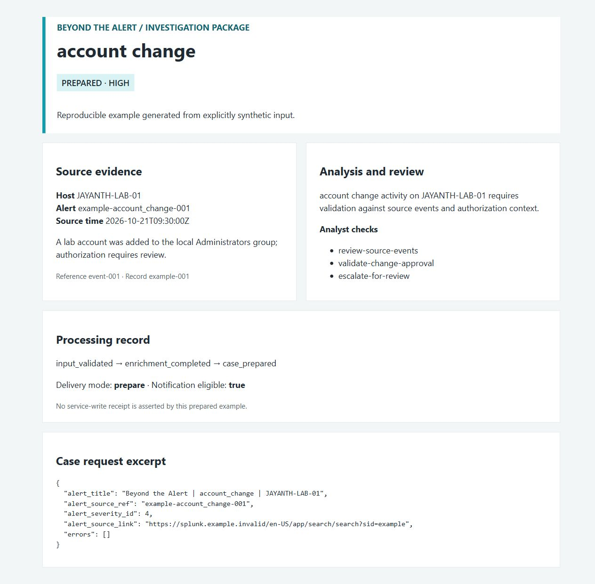

*Actual capture of the generated HTML view. Input and provider responses are synthetic; prepare mode contains no real IRIS/Slack delivery receipt. [Full-size image](assets/account-change-example.png) · [Analyst walkthrough](docs/investigation.md).*

</details>

## Tech Stack

| Layer | Components represented |
|---|---|
| Endpoint and lab | Windows, Sysmon, Kali Linux, VMware, Ubuntu |
| Detection | Splunk and maintained SPL examples |
| Orchestration and code | n8n, JavaScript, Node.js 24 |
| Advisory analysis and research | Configured LLM API, AbuseIPDB, VirusTotal |
| Case management and communication | DFIR-IRIS, Slack |
| Verification and documentation | Node test runner, GitHub Actions, Markdown, Word/PDF |

## Learning and Project Context

Beyond the Alert is an educational SOC investigation portfolio focused on evidence handling, identity validation, enrichment interpretation, prioritization, escalation and response planning. The lab design, supplied evaluation and maintained implementation have different evidence scopes, described in the [evidence policy](docs/evidence-policy.md).

## Project Scope

For authorized lab use. Analysts validate findings and authorize response actions. See [Validation Status and Next Milestones](#validation-status-and-next-milestones) for the verification scope and deployment checklist.

## Connect

**Jayanth** — [LinkedIn](https://www.linkedin.com/in/karri-jayanth/)
