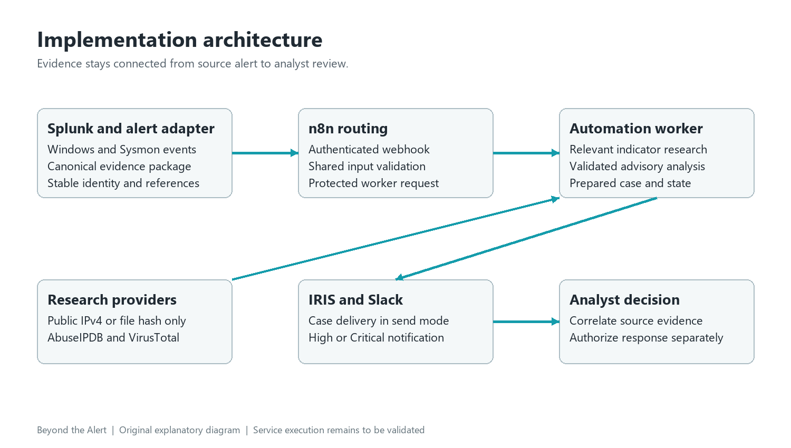
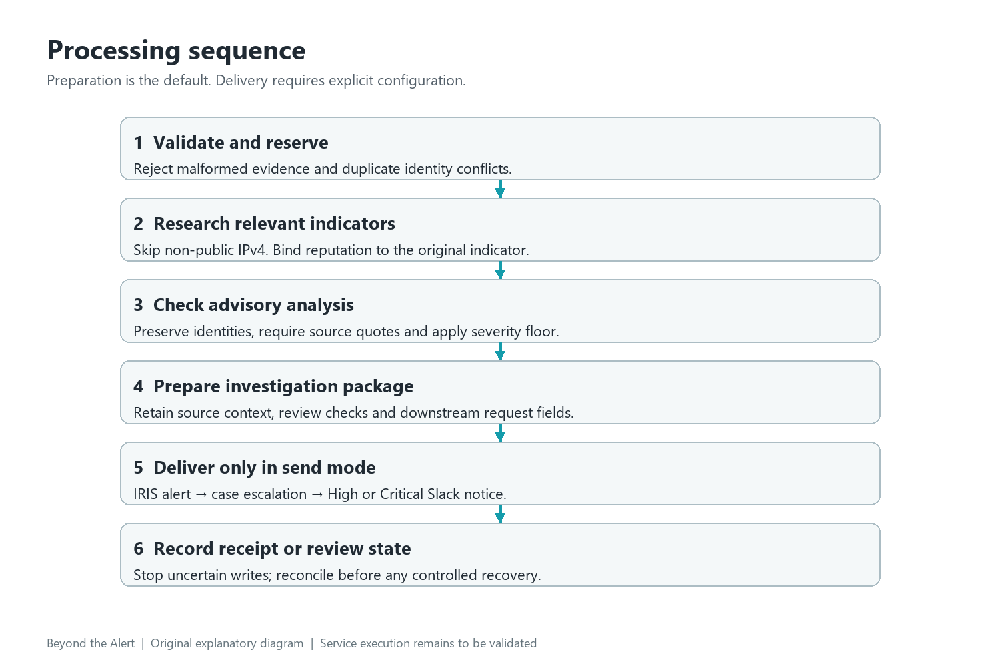

# Architecture

## Actual execution sequence

Splunk produces alert results. A separately configured mapping step must convert them into the canonical JSON described in [contracts](contracts.md). The stock Splunk webhook envelope is not accepted directly. n8n's intake uses Header Auth, validates the canonical body, and sends it through a second Header Auth credential to the worker over HTTPS. The worker validates again, reserves the alert identity, enriches relevant indicators, requests analysis, validates the response, applies policy, and prepares delivery payloads.

In prepare mode, the pipeline stops at an inspectable package. It still uses configured external research and model adapters unless the deterministic example adapters are selected. Prepare mode means no downstream case or notification writes; it does not mean no network requests. The example command uses substitutes for all providers.

In send mode, IRIS receives an alert through `/alerts/add`; a successful ID is then escalated through `/alerts/escalate/{id}`. A High or Critical assessment is sent to Slack after case creation. Medium findings still receive a case in send mode but no Slack notification. A delivery receipt is evidence only for the returned operation, not proof of correct investigation or containment.

## Trust boundaries

Use a trusted reverse proxy for TLS termination. The worker binds loopback by default; do not expose its HTTP listener directly. Keep the n8n intake secret distinct from `JAYANTH_WORKER_TOKEN`. Configure request-size and access controls at the proxy too. n8n execution-error history may retain request data and must have restricted access and retention settings.

Logs, commands, usernames and provider responses are untrusted. The model receives serialized evidence as user content, a fixed system contract, and no tools. Source links are retained for investigation and never fetched by the worker. External endpoints are fixed, except a validated HTTPS IRIS origin. Default TLS trust and redirect rejection remain enabled.

## State and failure behavior

The file store reserves each `(source, alert_id)` once and persists its payload fingerprint and stages. Identical repeats return the earlier result. Reuse of an ID for different content becomes an identity conflict. Partial delivery is retained rather than automatically retried: a timeout may occur after a server accepted a write. Check IRIS and Slack before any operator-approved recovery.

This store supports a single worker host on a local filesystem. It is not a distributed queue, an exactly-once delivery guarantee, or a high-availability database. Add transactional shared state and explicit reconciliation before scaling out.
