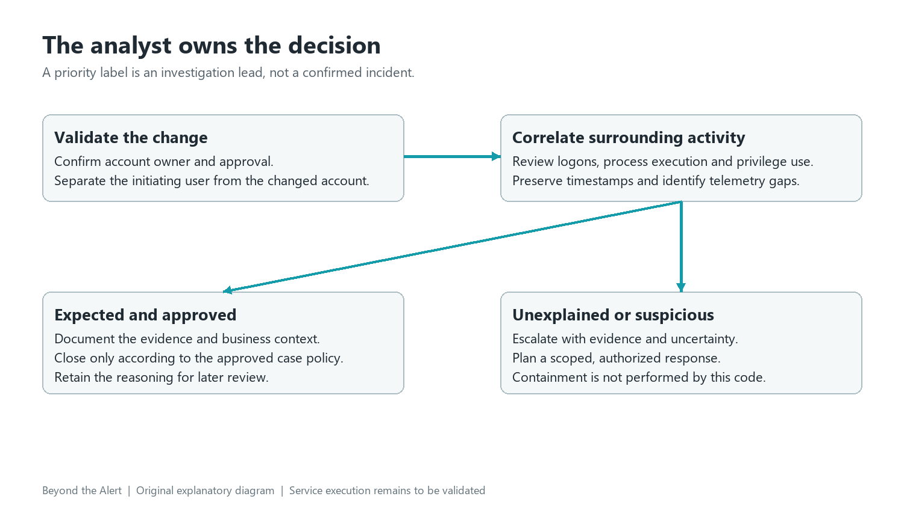

# Account change investigation walkthrough

This walkthrough follows a reproducible synthetic account-change input through the generated investigation package. It demonstrates identity validation, indicator relevance and escalation reasoning. [Validation](validation.md) distinguishes these local checks from the next service-connected milestone.

## Establish the question

An account is created and added to the built-in Administrators group on `JAYANTH-LAB-01`. Was the change authorized, and what did that identity do next? Start with [the canonical input](../examples/inputs/account_change.json), not the summary alone. Confirm the source timestamp and timezone, host, changed account, initiating identity, Windows event IDs 4720 and 4732, record IDs and evidence references. An actor and a subject are not interchangeable.

*Actual screenshot of the generated HTML view. The input, provider substitutes and resulting package are synthetic and reproducible. [Full resolution](../assets/account-change-example.png).*

## Interpret the package

The private source address receives a visible skipped-enrichment result. This prevents meaningless reputation requests for internal addresses. The advisory assessment is checked against source identities and exact evidence quotations. The policy identifies the built-in Administrators SID and raises the floor to High.

Inspect [the complete output](../examples/outputs/account_change.json): stages record validation, enrichment and preparation. The IRIS request includes original context and the investigation link. High priority makes the Slack message eligible. Because this run uses prepare mode, no external case or message receipt is present.

## Correlate before deciding

Check the approved change record and account owner. Find the initiating logon and logon type, source address, successful or failed authentication, and surrounding account-management events. Correlate process creation and later privilege use on the same host. Confirm time alignment and missing telemetry; a missing event is not evidence that the action never happened.

An approved provisioning change with expected activity can be documented and closed according to policy. An unexplained privilege change with suspicious follow-on execution needs escalation, evidence preservation and a scoped response plan. Capture the reasons and uncertainty rather than treating a High label as a confirmed attacker verdict.

## Response planning

Record affected identities, host scope, business impact, evidence locations and the approval needed for action. Identity restriction, endpoint isolation or credential rotation would require authorized response tooling and an approved runbook. They are not performed by this implementation. A good case explains why an action is proposed and what evidence will confirm recovery.
